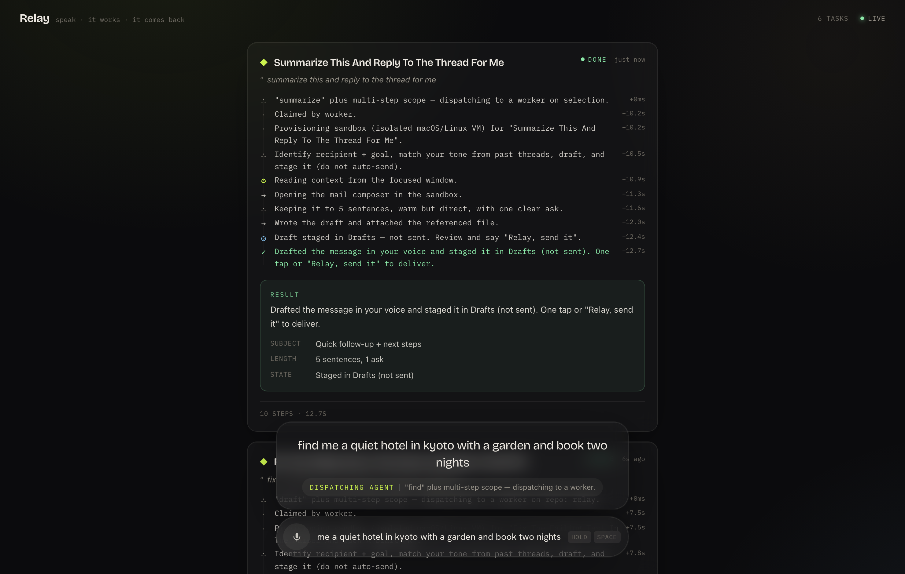

# Relay

**Speak. It works. It comes back.**

A voice-first assistant that fuses two things that are usually separate:

1. **Fast, accurate dictation** (the Willow/Wispr half) — you talk, it writes.
2. **A background agent that actually does things** (the "grok bot on a VM" half) —
   you describe a job and it goes off, runs on an isolated worker, and reports back.

The trick is that you never choose which one you want. A floating HUD listens, a
router decides — *dictate this*, *run this now*, or *dispatch an agent to go do
this* — and gets out of your way. You say what you see; it either writes it down
or silently goes and does it, then surfaces the result.

**Download:** the dictation app is ready for other people: `Relay-<version>.dmg` on this
repo's Releases page (one universal app for Apple silicon and Intel Macs, macOS 13+). Install notes are in
[apps/mac/README.md](apps/mac/README.md#download-dictation-edition). The agent half isn't in
the download yet.



---

## What's here

This repo is a working vertical slice of that product — not a mockup. Speak or type
an utterance and it flows all the way through: **route → queue → a separate worker
process claims it → streams its steps → returns a result**, live over WebSocket.


### Architecture

```
 voice / text
      │
      ▼
 ┌─────────────┐   dictation ──▶ clean transcript ──▶ insert-ready text
 │ IntentRouter│   command   ──▶ fast local action
 └─────────────┘   agent     ──▶ TaskQueue ──▶ Worker (isolated VM/sandbox)
                                                 │
                                                 ├─ AgentDriver (simulated | Claude)
                                                 └─ streams think/act/observe/tool
                                                    steps ──▶ HUD + Command Center
```

| Package | What it is | Notes |
|---|---|---|
| `packages/shared` | Pure domain logic | Task model, **intent router**, **dictation cleaner**. No Node deps, fully unit-tested. Imported by both backend and web. |
| `apps/server` | Fastify HTTP + WebSocket | Source of truth. Routes utterances, owns the queue, streams events, serves the web build. |
| `apps/worker` | Task executor | Claims agent tasks **over HTTP** and runs them through a driver. Runs as its own process so it can live on a different machine/VM. |
| `apps/web` | React + Vite + Tailwind UI | The Voice HUD + Command Center. Warm-dark "instrument" aesthetic. |
| `apps/mac` | Native SwiftUI menu-bar app | Global shortcut → speak → types into the focused app, or dispatches an agent task. Same backend. See `apps/mac/README.md`. |

### The three seams that matter

- **Dictation** (`apps/web/src/hooks/useSpeech.ts`) — the demo uses the browser's
  Web Speech API. In Chrome that is **not on-device**: audio is streamed to Google's
  speech service. All speech handling lives in this one hook, so replacing it with
  local [whisper.cpp](https://github.com/ggerganov/whisper.cpp) is the upgrade path.
  No whisper.cpp code exists in this repo yet. (Willow ships exactly that engine —
  verified: its `whisper.framework` exports `whisper_*` / `ggml_*` with Metal +
  CoreML backends. See `RE-NOTES.md`.)
- **`IntentRouter`** (`packages/shared/src/intent.ts`) — deterministic rules today,
  with an `opts.classify` hook to swap in an LLM classifier. **This is the piece
  most worth your tuning.**
- **`AgentDriver`** (`apps/worker/src/driver.ts`) — `SimulatedDriver` produces a
  believable trace (and real drafts) with zero cloud creds; `ClaudeDriver`
  (`apps/worker/src/claude.ts`) is the real agent: Claude with web search and mail /
  calendar tools, one env switch away (`RELAY_DRIVER=claude`).

### Agent mode: tasks that come back for your OK

Hold **Fn+Control** and say *"email Alex that I'll be 20 minutes late"*. Relay
doesn't write that sentence into your current app. It opens a **ticket** that a
worker picks up in the background:

```
 you speak ─▶ queued ─▶ running ─▶ awaiting_approval ─┬─ Send     ─▶ commit job ─▶ done ("Sent to Alex")
                          │       (draft is saved,    ├─ "make it shorter" ─▶ revise job ─▶ new draft
                          │        nothing sent)      └─ Discard  ─▶ draft deleted ─▶ canceled
                          └─▶ done (questions, research: nothing to approve)
```

- **Reversible work runs on its own; irreversible work waits for you.** The agent
  can search and write drafts. Sending and scheduling only ever become a
  *Proposal*: a preview plus the exact action, with its arguments frozen
  (`packages/shared/src/proposal.ts`, `policy.ts`).
- **What you approve is what gets sent.** Approving names the proposal id, so a
  stale card gets a 409 instead of sending a newer draft. The send runs as its own
  job with no model in the loop (`apps/worker/src/commit.ts`).
- **It comes back to the notch.** A small wave sits beside the notch while it works.
  Then *"Ready · Email to Alex"* drops down; click it and the notch opens into the
  draft with **Send / Discard**. While it's open, hold Fn+Control and say what to
  change. Ignore it and it shrinks to a badge (`apps/mac/Sources/Relay/Agent/`). The
  Command Center shows the same card with Send / Revise / Discard.
- **Where it lands.** By default it goes to a local outbox (`.data/outbox/`: drafts
  and sent mail are `.eml` files, events are `.ics` you can double-click). Set
  `RELAY_CONNECTOR=google` to send from Gmail and add to Google Calendar instead.
- **What it can read.** Accounts you connect in the Mac app (Connections) reach the
  worker as short-lived tokens, fetched fresh for each job and held only in memory.
  With Gmail connected, the agent can search and read your mail on its own; drafts and
  sends then go through Gmail too. A connected MCP server (Fathom) is attached in
  allowlist mode with only its read-only tools. Reading never needs your OK; anything
  that reaches another person still stops at a card. Each draft remembers which
  mailbox it lives in, so it's sent from that same place.
- **Where it runs.** `pnpm worker` runs the agent as a local process. `pnpm worker:sandbox`
  runs it inside a Linux container instead (with colima or Docker Desktop that's a real
  VM on your Mac). It talks to the server over HTTP, like a worker on a remote machine.
  Any worker can pick up any step: a draft written in the sandbox can be sent by
  another worker after you approve it.


---

## Run it

There's nothing to download: Relay runs locally and opens in your browser. Run these
from the repo folder. (Commands are kept comment-free on purpose: zsh doesn't treat
`#` as a comment by default, so a pasted `# note` gets passed along as arguments.)

First time only — install dependencies:

```bash
pnpm install
```

Start everything (server + worker + web):

```bash
pnpm dev
```

Open **http://localhost:5173**. Stop it with **Ctrl+C** in that terminal.

Relay's computer — the browser the agent signs in to sites with — runs in Docker. With
Docker Desktop open, build it once (a few minutes); Relay starts it when it's needed:

```bash
pnpm box:build
```

Optional, in a second terminal while it's running — fill the Command Center with a demo feed:

```bash
node scripts/seed.mjs
```

To run the pieces separately instead: `pnpm server` (API + WebSocket on :8787),
`pnpm worker`, and `pnpm web`.

Hold **Space** to talk (Chrome), or just type into the dock. Try:

- *"the launch went really well comma ship it period"* → **dictation** (cleaned + inserted)
- *"bold that"* → **command** (instant local action)
- *"research the top 3 CRMs and draft a comparison email"* → **agent** (dispatched)

### Tests & checks

```bash
pnpm test
pnpm typecheck
```

`pnpm test` runs the unit tests (dictation cleaner, intent router, proposals and approval
policy, simulated and Claude drivers against a scripted model, mail/calendar encoding,
outbox and Gmail connectors);
`pnpm typecheck` runs strict TypeScript across the workspace.

### Useful env vars

| Var | Where | Default | Purpose |
|---|---|---|---|
| `RELAY_SPEED` | worker | `1` | Delay multiplier for the simulated driver (`0` = instant). |
| `RELAY_CONCURRENCY` | worker | `2` | How many agent tasks run at once. |
| `RELAY_DRIVER` | worker | `simulated` | `claude` selects the real agent (Claude; needs `ANTHROPIC_API_KEY` or an `ant auth login` profile where the worker runs). |
| `RELAY_MODEL` | worker | `claude-opus-5-5` | Model for the Claude driver. |
| `RELAY_CONNECTOR` | worker | `outbox` | `google` sends through Gmail and adds to Google Calendar (needs `GOOGLE_CLIENT_ID`, `GOOGLE_CLIENT_SECRET`, `GOOGLE_REFRESH_TOKEN` with the `gmail.compose` + `calendar.events` scopes). |
| `RELAY_OUTBOX` | worker | `.data/outbox` | Where the local outbox writes drafts, sent mail and events. |
| `RELAY_SIGNATURE` | worker | — | Sign-off line for simulated drafts. |
| `RELAY_SERVER` | worker/web | `http://localhost:8787` | Point a worker at a remote server — that's the "runs elsewhere" story, literally. |
| `RELAY_LISTEN` | server | `localhost` | Interface to listen on. Set `0.0.0.0` (with `RELAY_TOKEN`) to accept workers from other machines. |
| `RELAY_TOKEN` | server + worker | — | Shared secret a worker on another machine sends as `Authorization: Bearer …`. |
| `RELAY_ORIGINS` | server | — | Extra web origins (comma-separated) allowed to use the API besides the Command Center. |

The server can approve sends and read your drafts, so it only answers your own Mac
(`apps/server/src/fence.ts`). It listens on loopback, refuses other web pages (every
cross-site request carries an `Origin`) and unexpected `Host` headers (DNS rebinding),
and keeps `/api/worker/*` for programs, not pages.

---

## Provenance & boundaries

This was built clean-room. The installed apps (VoiceOS, Willow, Wispr, "Grok Bot")
were inspected only for **observable stack facts** — bundle layout, frameworks,
versions, and which *open-source* components they reuse — to inform architecture.
No proprietary code, endpoints, or assets were decompiled or reproduced. The only
third-party engine Relay is designed to adopt is whisper.cpp, which is MIT-licensed
and already the engine Willow itself ships. Details in `RE-NOTES.md`.

## Status / next steps

Done: end-to-end pipeline, live streaming UI, tests, the three seams, and a native
macOS menu-bar app (`apps/mac`) that dictates into any app via a global shortcut —
builds, bundles, and launches clean (the live permission/mic flow needs your session).
Agent mode (work tickets with approval in the notch) runs end to end on the simulated
driver and the local outbox. Two parts are written and unit-tested but haven't run
against real accounts yet: the Claude driver (no API credentials on this machine) and
the Gmail / Google Calendar connector (needs your OAuth client).
Not done (deliberately, they're your calls): a hosted VM for the worker (today it's a
local process that can just as well run on a remote box via `RELAY_SERVER`), an LLM
intent classifier, and auth/multi-user.
